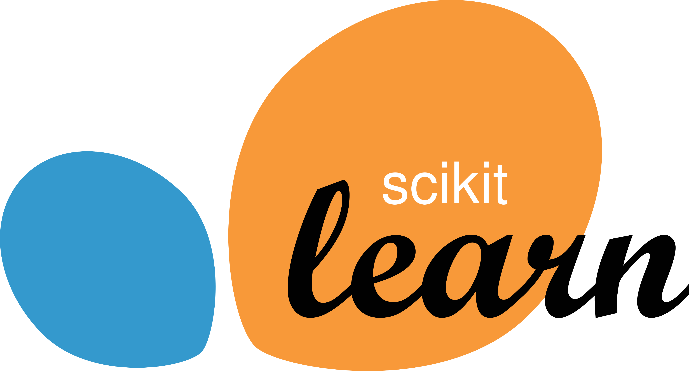

# Scikit-learn: funcionamiento básico



Scikit-learn (`sklearn`) es una biblioteca de Python para aprendizaje automático clásico. Incluye algoritmos para clasificación, regresión, agrupamiento y reducción de dimensionalidad, además de herramientas para preparar datos y medir el rendimiento de los modelos.

## Flujo habitual

1. Organiza los datos de entrada en `X` (filas = ejemplos, columnas = características) y, si es aprendizaje supervisado, las respuestas correctas en `y`.
2. Separa datos de entrenamiento y de prueba con `train_test_split`.
3. Crea un estimador, por ejemplo `RandomForestClassifier`.
4. Entrena el estimador con `fit(X_train, y_train)`.
5. Obtén predicciones con `predict(X_test)` y mide su calidad con métricas adecuadas.

```python
from sklearn.datasets import load_iris
from sklearn.model_selection import train_test_split
from sklearn.ensemble import RandomForestClassifier
from sklearn.metrics import accuracy_score

X, y = load_iris(return_X_y=True)
X_train, X_test, y_train, y_test = train_test_split(
    X, y, test_size=0.2, random_state=42, stratify=y
)

modelo = RandomForestClassifier(random_state=42)
modelo.fit(X_train, y_train)
predicciones = modelo.predict(X_test)
print(accuracy_score(y_test, predicciones))
```

## Conceptos importantes

- **Estimador:** objeto que aprende de los datos. Los métodos más comunes son `fit`, `predict` y `score`.
- **Preprocesamiento:** escalado de números, codificación de categorías e imputación de valores ausentes. Los transformadores suelen usar `fit` y `transform`.
- **Pipeline:** encadena preparación y modelo para aplicar los mismos pasos al entrenar y predecir, reduciendo errores y fugas de información.
- **Validación:** la puntuación de prueba estima el rendimiento en datos no vistos. La validación cruzada permite una evaluación más estable.
- **Métrica:** elige una métrica acorde al objetivo; la exactitud no siempre es adecuada si las clases están desequilibradas.

Instalación: `pip install scikit-learn`. Importa sus componentes desde `sklearn`.
